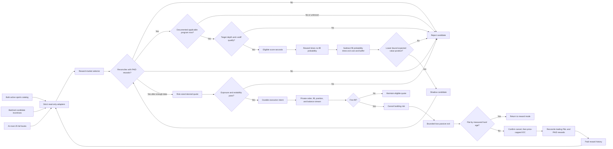
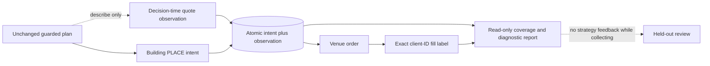

# Architecture

The bot is a gated pipeline. Reward eligibility alone never authorizes an
order, and an advertised pool is never treated as expected income.

The live selector bulk-joins executable sports metadata to incentive programs
every 15 minutes while keeping only one execution scope. It performs a bounded
25-book deep pass and round-robins deferred programs. Before changing the selected
slug, the existing executor cancels its quotes and proves the whole account
flat, order-free, resolved, and owned; only then are singleton streams rebound.

### Observation-only branch

For a building post-only action, the runner may construct an immutable
decision-time observation after the normal planner has already chosen the
action. The execution ledger writes that observation and its PLACE intent in
one transaction, using the exact client order ID that later appears on orders
and fills. If construction fails, the intent is marked as requiring an
observation so the coverage report exposes the gap, while the unchanged action
continues. Observation fields have no edge back into the planner, reconciler,
risk gate, scheduler or wire payload.

The public commissioning stream currently supplies books only. Trade-volume
fields therefore remain explicitly unknown rather than being inferred from
the bot's own fills, and no league grouping or filtering is part of this path.

## Current boundary

Implemented:

- Phase 0 pure reward and risk decisions
- Phase 1 strict read-only REST and WebSocket adapters
- Phase 2 persistent shadow measurement and paid-only calibration storage
- Phase 3 durable intent, exact-decimal execution ledger, and reconnect
  reconciliation
- Phase 4 desired-state inventory/exit reconciler and adversarial dry runs
- Phase 5 readiness evaluator plus an explicitly armed, one-contract
  commissioning runner with runtime risk, private-stream freshness, persisted
  restart recovery, and market-scoped shutdown

Not implemented:

- sufficient multi-day shadow and selected-horizon evidence
- a supervised exchange kill-switch test
- controlled live reward/P&L evidence or permission to scale

The economic readiness verdict remains red. The commissioning command is an
operator-accepted, non-scalable evidence collection exception with fixed one-
market/one-contract limits; it does not change the scale gate.

## Live state sequence

The private WebSocket has no durable replay cursor. Connecting or reconnecting
therefore does not authorize trading by itself. A session must connect, take a
whole-account REST snapshot, receive complete private order and balance
snapshots, and remain fresh before the action driver can add risk. A disconnect,
unknown message, incomplete snapshot, ambiguous mutation, unowned order, or
stale marked equity revokes that permission while preserving cancel/exit paths.
