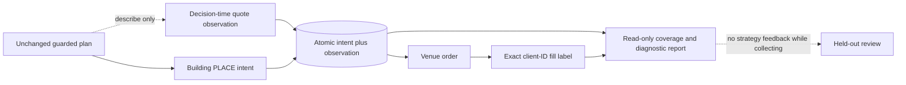

# Architecture

The bot is a gated pipeline. Reward eligibility alone never authorizes an
order, and an advertised pool is never treated as expected income.

```mermaid
flowchart LR
    A[Bulk active sports catalog] --> D[Strict read-only adapters]
    B[Batched candidate incentives] --> D
    C[At most 100 full books] --> D
    H[Paid reward history] --> D
    D --> DS[Reward-market selector]
    DS --> M{V2 moneyline and spread at least 2c?}
    M -- No --> X[Reject candidate]
    M -- Yes --> E{Documented applicable program now?}
    E -- No or unknown --> X[Reject candidate]
    E -- Yes --> F{Target depth and cutoff qualify?}
    F -- No --> X
    F -- Yes --> G[Reward-eligible candidate]
    G --> I[Compute score, no-fill reward, and stressed-exit EV telemetry]
    I --> J[Rank with projected and historical reward evidence]
    J --> K[Bind or safely top up at most 20 active markets]
    K --> N[Risk-sized desired quote]
    N --> O{Freshness, ownership, exposure, and exitability pass?}
    O -- No --> X
    O -- Yes --> P[Durable execution intent]
    P --> Q[Private order, fill, position, and balance stream]
    Q --> R{First fill?}
    R -- No --> S[Maintain eligible quote]
    R -- Yes --> T[Cancel building risk]
    T --> U[Exact passive reducer at active touch]
    U --> V{Flat by measured hard age?}
    V -- Yes --> W[Return to reward mode]
    V -- No --> Y[Confirm cancel, then price-capped IOC]
    Y --> Z[Reconcile trading P&L and PAID rewards]
    Z --> H
```



The live selector bulk-joins executable sports metadata to incentive programs
every 15 minutes and maintains one executor across at most 20 selected markets.
It performs a bounded 100-book deep pass and round-robins deferred programs.
Full rotation still requires whole-account flat, order-free, resolved, and
owned proof. Incremental top-up preserves healthy markets and resting orders,
releases only flat/order-free/resolved owners whose event or exact authorizing
reward phase no longer applies, and cannot exceed the 20-slot cap. Complete
account snapshots remain global; strict individual reads are scoped to owners
being released, while retained ambiguity remains behind its owner's gate. The
EV model is measured and logged but remains
advisory while `enforce_reward_cost_gate` is false.

If the final near-deadline position becomes positively flat while mandatory
holes exist, a one-shot scheduler edge reaches incremental top-up before the
ordinary full-slate service pass. It may use a two-minute selection cache only
through fresh candidate metadata, incentive and book validation; exit priority,
ownership proof and the optional-idle cadence are unchanged.

### Observation-only branch

For a building post-only action, the runner may construct an immutable
decision-time observation after the normal planner has already chosen the
action. The execution ledger writes that observation and its PLACE intent in
one transaction, using the exact client order ID that later appears on orders
and fills. If construction fails, the intent is marked as requiring an
observation so the coverage report exposes the gap, while the unchanged action
continues. Observation fields have no edge back into the planner, reconciler,
risk gate, scheduler or wire payload.



The strategy-authorizing commissioning stream continues to supply books only.
An optional measurement branch uses a separate bounded public-trade socket to
maintain conservative lower/upper queue-ahead bounds for the exact building
client order ID. Stream health and coverage gaps are durable. Its 60-second,
upper-bound-at-most-one-order shadow signal has no edge back into the planner
or action driver and cannot cancel or replace an order. Decision-time
trade-volume fields remain explicitly unknown rather than being inferred from
the bot's own fills, and no league grouping or filtering is part of either
observation path.

## Current boundary

Implemented:

- Phase 0 pure reward and risk decisions
- Phase 1 strict read-only REST and WebSocket adapters
- Phase 2 persistent shadow measurement and paid-only calibration storage
- Phase 3 durable intent, exact-decimal execution ledger, and reconnect
  reconciliation
- Phase 4 desired-state inventory/exit reconciler and adversarial dry runs
- Phase 5 readiness evaluator plus an explicitly armed, one-contract
  commissioning runner with runtime risk, private-stream freshness, persisted
  restart recovery, and market-scoped shutdown

Not implemented:

- sufficient multi-day shadow and selected-horizon evidence
- a supervised exchange kill-switch test
- controlled live reward/P&L evidence or permission to scale

The economic readiness verdict remains red. The commissioning command is an
operator-accepted, non-scalable evidence collection exception with fixed one-
market/one-contract limits; it does not change the scale gate.

## Live state sequence

The private WebSocket has no durable replay cursor. Connecting or reconnecting
therefore does not authorize trading by itself. A session must connect, take a
whole-account REST snapshot, receive complete private order and balance
snapshots, and remain fresh before the action driver can add risk. A disconnect,
unknown message, incomplete snapshot, ambiguous mutation, unowned order, or
stale marked equity revokes that permission while preserving cancel/exit paths.
Recovery starts its replacement private listener before sending quarantine
cancels, and recovery/shutdown drain buffered terminal events before falling
back to lagging individual REST reads.

## Runner layering (generated map, 2026-09-26)

The trader class is built in three layers:
1. `CommissioningRunner`, whose methods live in `live_commissioning.py` plus eleven `runner_*.py` mixins;
2. `RestFallbackRunner` (`rest_fallback.py`);
3. `AccountSourceRunner` (`account_source_runner.py`, the hybrid/REST source actually launched by `_run`).

A method overridden in both subclasses executes three layers deep, so tracing it means reading every layer. Print the current map with:

```bash
python -B scripts/runner_layers.py
```

On 2026-09-26, 77 methods are overridden below `CommissioningRunner`, and 9 run three layers deep:
- `__init__`, `preflight`, `_rest_reconcile`;
- `_refresh_execution_state_for_decision`;
- `_read_owned_order_states`, `_read_exact_order_states`;
- `_reconcile_position_state`, `_fetch_execution_history`, `_set_source_descriptions`.

Account-proof and order-read bugs, such as the 2026-09-26 404 stall, live in this set. `tests/test_runner_layers.py` keeps the map honest against the real classes.

Structural refactoring (splitting `run()` or extracting account-proof and owner-scheduler objects) was reviewed on 2026-09-26 and deferred. Its planned driver, a decision-loop redesign, was measured as not worth building (RESTING_EFFICIENCY_2026-09-26), and `run()`'s loop keeps about a dozen interdependent timers as locals, so extraction would rewrite the live core for maintainability alone.
